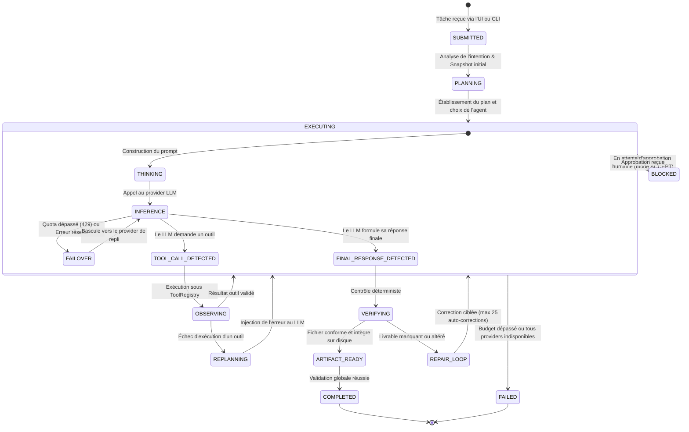

# 🧠 Architecture de NeoHarness AI & Fonctionnement de la Boucle Agentique

Ce document présente le fonctionnement interne complet du système **NeoHarness AI** couplé aux modèles de langage (**LLM**), détaillant la **boucle agentique fermée**, la résilience multi-fournisseurs, l'exécution sécurisée des outils et la validation des artefacts.

---

## 1. Vue d'Ensemble des Composants

```mermaid
flowchart TD
    subgraph UI_Layer ["🖥️ Couche Interface (Cockpit Web)"]
        UI["Cockpit Web (app.js / index.html)"]
        SSE["Stream SSE (/api/events)"]
        REST["API REST (/api/task, /api/preview)"]
    end

    subgraph Bus_Layer ["⚡ Couche Événements & Synchronisation"]
        EB["NormalizedEventBus (core/event_bus.py)"]
        ET["EventTranslator (core/events.py)"]
    end

    subgraph Core_Orchestration ["🧭 Couche Orchestration & Décision"]
        ORCH["Orchestrator (core/orchestrator.py)"]
        INTENT["IntentEngine (core/intent_engine.py)"]
        ROUTER["ModelRouter (core/router.py)"]
        PLANNER["Planner (core/planner.py)"]
        COORD["MultiAgentCoordinator (core/multi_agent_coordinator.py)"]
        DELEG["DelegationEngine (core/delegation.py)"]
    end

    subgraph Agent_Loop_Layer ["🔄 Moteur d'Exécution : Boucle Agentique"]
        LOOP["AgentLoop.run() (core/agent_loop.py)"]
        BUDGET["MissionBudget (tokens, temps, outils)"]
        SHADOW["Shadow Git (core/checkpoint.py)"]
    end

    subgraph LLM_Providers ["🤖 Couche Modèles (LLM Providers)"]
        GEMINI["GeminiProvider (Flash / Flash-Lite / Pro)"]
        OPENAI["OpenAIProvider (GPT-4o / GPT-5-mini)"]
        MISTRAL["MistralProvider (Mistral-Small)"]
        OLLAMA["OllamaProvider (qwen, llama local)"]
    end

    subgraph Tool_Execution ["🛠️ Couche Outils & Sandboxing"]
        REGISTRY["ToolRegistry (tools/registry.py)"]
        PERMS["PermissionPolicy (core/permissions.py)"]
        FS["WorkspaceFilesystem (tools/filesystem.py)"]
        PANDOC["Pandoc Local (runtime/pandoc/pandoc.exe)"]
        TECTONIC["Tectonic / LaTeX (tools/compiler.py)"]
        BROWSER["Playwright Dynamic (tools/browser.py)"]
        PY_SANDBOX["Python Sandbox (tools/python_runtime.py)"]
    end

    subgraph Artifact_Verification ["🛡️ Validation & Artefacts"]
        VERIFIER["Verifier Déterministe (core/verifier.py)"]
        ART_ENG["UniversalArtifactEngine (core/artifacts/engine.py)"]
        PROV["Provenance Ledger SHA-256"]
    end

    UI --> REST
    REST --> ORCH
    EB --> SSE --> UI
    ORCH --> INTENT
    ORCH --> ROUTER
    ORCH --> PLANNER
    ORCH --> LOOP

    LOOP --> BUDGET
    LOOP --> SHADOW
    LOOP --> ROUTER
    ROUTER --> GEMINI & OPENAI & MISTRAL & OLLAMA

    LOOP <--> REGISTRY
    REGISTRY --> PERMS
    REGISTRY --> FS & PANDOC & TECTONIC & BROWSER & PY_SANDBOX

    LOOP --> VERIFIER
    VERIFIER --> ART_ENG
    ART_ENG --> PROV
    ART_ENG --> EB
    LOOP --> EB
```



---

## 2. Déroulement Pas à Pas de la Boucle Agentique (`AgentLoop`)

La méthode `AgentLoop.run()` est une boucle fermée déterministe qui prend en charge une tâche utilisateur et itère jusqu'à l'obtention d'un résultat vérifiable ou l'épuisement d'un garde-fou.

### Étape 1 : Initialisation & Budget
1. **Création du Budget de Mission** (`MissionBudget`) :
   - Plafond de tokens (ex: 100 000 tokens).
   - Plafond de temps d'exécution (ex: 300 secondes).
   - Plafond d'appels d'outils (ex: 50 outils max).
2. **Snapshot d'État Initial** :
   - Point de restauration Git local (`.neoharness/shadow.git`) pour pouvoir annuler toute modification destructive en cas d'échec ou d'impasse.
3. **Planification Déterministe** :
   - Le `Planner` génère une liste d'étapes cibles (`PlanStep`) et émet l'événement `PLAN_CREATED`.
   - La première étape passe en `in_progress`.

### Étape 2 : Préparation du Prompt & Filtrage des Outils
1. **Génération du Prompt Système & Contexte** :
   - Rôle de l'agent actif (`Coder`, `Researcher`, `Reviewer`, `Tester`).
   - Observations accumulées (sorties d'outils précédentes encapsulées contre l'injection de prompt via `<donnees_non_fiables>`).
   - Consignes spécifiques de la compétence (ex: formats demandés, gabarits LaTeX ou DOCX).
2. **Filtrage des Outils Autorisés (`schemas`)** :
   - Seuls les outils déclarés dans le profil de l'agent ou la compétence active sont transmis au modèle.
   - En mode `PLAN`, tous les outils mutants (écriture, commande shell) sont retirés au profit d'outils de lecture seule.

### Étape 3 : Consultation du LLM & Streaming
1. **Appel au Fournisseur LLM** :
   - Appel de `provider.generate_agent_turn(prompt, active_schemas, tool_results, ...)`.
   - Streaming en temps réel des fragments de texte vers l'UI via `stream_callback` et le bus SSE.
2. **Failover Automatique en Cas d'Erreur Provider** :
   - Si une erreur réseau ou un dépassement de quota (HTTP 429 / Resource Exhausted) survient :
     - Le provider défaillant est marqué comme exclu (`exhausted_providers`).
     - Le `ModelRouter` sélectionne automatiquement le fournisseur de repli éligible (ex: Gemini -> OpenAI -> Mistral -> Ollama).
     - La boucle reprend sans perte d'historique.

### Étape 4 : Détection d'Action & Exécution d'Outils
1. **Analyse de la Réponse du Modèle** :
   - **Cas A : Le modèle demande un ou plusieurs outils (`turn.tool_calls`)** :
     - Transition vers l'état `OBSERVING`.
     - Émission de l'événement `TOOL_CALL` (visible en direct dans le panneau d'activité de l'UI).
     - Pour chaque outil, `ToolRegistry` vérifie les droits (`PermissionPolicy`). Si l'action nécessite une confirmation humaine (ex: écriture en mode `ACCEPT`), l'exécution est suspendue en attente de validation.
     - L'outil s'exécute dans un environnement sécurisé (ex: `WorkspaceFilesystem` isolé dans `workspace/`, sans accès au système hôte).
     - Le résultat est capturé, horodaté et retourné sous forme d'observation.
   - **Cas B : Le modèle fournit une réponse textuelle directe** :
     - Clôture des étapes d'activité.
     - Transition vers la vérification.

### Étape 5 : Ré-injection des Observations & Re-planification
- Si l'un des outils a échoué (ex: commande invalide, fichier introuvable, erreur de compilation LaTeX) :
  - Le système émet un événement `REPLAN`.
  - L'erreur complète est injectée au modèle pour qu'il s'auto-corrige au tour suivant (**Boucle de compilation fermée** ou **TDD Red-Green**).

### Étape 6 : Validation Déterministe & Matérialisation d'Artefacts
1. **Validation de la Réponse Finale** :
   - L'agent exécute son validateur métier (`validate_final_answer`).
   - L'oracle déterministe (`Verifier`) s'assure que les exigences de la tâche sont satisfaites.
2. **Matérialisation Automatique des Fichiers Demandés** :
   - Si un fichier **Word** (.docx) est demandé : conversion native du Markdown/LaTeX en XML OMML via Pandoc local (`runtime/pandoc/pandoc.exe`).
   - Si un fichier **PDF** est demandé : compilation Tectonic sous boucle d'auto-correction.
   - Vérification physique sur disque : existence, taille > 0, signature magique (ex: `PK` pour DOCX, `%PDF-` pour PDF), calcul de l'empreinte SHA-256.
   - Émission de `ARTIFACT_READY` avec URL de prévisualisation directe.

### Étape 7 : Livraison Finale & Clôture
- Enregistrement de la trace dans `workspace/.harness/conversations.json` et du registre de provenance.
- Envoi de l'événement `TASK_COMPLETED` à l'interface utilisateur.

---

## 3. Diagramme de Séquence de la Boucle Agentique

```mermaid
sequenceDiagram
    autonumber
    actor User as 👤 Utilisateur
    participant UI as 🖥️ UI Cockpit (app.js)
    participant Server as 🌐 Server (ui/server.py)
    participant Orchestrator as 🧭 Orchestrator
    participant Loop as 🔄 AgentLoop
    participant Router as 🔀 ModelRouter
    participant LLM as 🤖 LLM Provider (Gemini/OpenAI/Ollama)
    participant Registry as 🛠️ ToolRegistry
    participant Tool as ⚙️ Tool (Pandoc/LaTeX/Filesystem)
    participant Verifier as 🛡️ Verifier & ArtifactEngine

    User->>UI: Saisie du prompt ("Crée un exercice en format Word")
    UI->>Server: POST /api/task { prompt, mode }
    Server->>Orchestrator: run_agentic(task)
    Orchestrator->>Router: get_provider(intent)
    Router-->>Orchestrator: provider sélectionné
    Orchestrator->>Loop: run(agent, task)

    loop Itérations Agentiques (max 15)
        Loop->>Server: Event(agent.thinking) -> SSE -> UI
        Loop->>LLM: generate_agent_turn(prompt, schemas, observations)
        LLM-->>Server: stream delta chunks -> SSE -> UI
        LLM-->>Loop: ToolCall(generate_docx, {content, output_path})

        Loop->>Server: Event(tool.started, tool="generate_docx") -> SSE -> UI
        Loop->>Registry: execute("generate_docx", args)
        Registry->>Tool: Exécution locale Pandoc
        Tool-->>Registry: Fichier DOCX créé (16 Ko)
        Registry-->>Loop: ToolExecution(status="success", result={...})
        Loop->>Server: Event(tool.completed) -> SSE -> UI

        Loop->>LLM: generate_agent_turn(observations=[ToolResult])
        LLM-->>Loop: "Le document Word a été généré avec succès."
    end

    Loop->>Verifier: verify(deliverables)
    Verifier->>Verifier: Check existence, taille > 0, signature ZIP/PK
    Verifier-->>Loop: VerificationResult(status="passed")

    Loop->>Server: Event(ARTIFACT_READY, {path, docx}) -> SSE -> UI
    Loop-->>Orchestrator: AgentResult(status=COMPLETED)
    Orchestrator-->>Server: Mission terminée
    Server-->>UI: Event(TASK_COMPLETED)
    UI-->>User: Affichage de la réponse + Carte Artefact Word avec bouton Télécharger
```

---

## 4. Machine à États de la Tâche (`TaskState`)



---

## 5. Résilience & Protection Multi-Fournisseurs (Failover)

Le système implémente une matrice de tolérance aux pannes pour empêcher tout blocage :

| Événement | Détection | Action Immédiate du Harness |
| :--- | :--- | :--- |
| **Dépassement de Quota (HTTP 429)** | Exception de type `quota`, `rate_limit` ou `ResourceExhausted` | Le provider est exclu définitivement pour la mission. Le `ModelRouter` bascule instantanément vers le modèle suivant sans redémarrer la session. |
| **Boucle Infinie / Ping-Pong** | Même famille de modèle déjà en échec | Exclusion groupée de toute la famille (ex: si Gemini Flash échoue sur quota, Gemini Flash-Lite et Gemini Pro sont également écartés). |
| **Fournisseur muet (Tours vides)** | 3 tours consécutifs sans texte ni appel d'outil | Interruption de la trajectoire pour éviter la consommation inutile de tokens, déclenchement du rapport d'incident. |
| **Erreur de Compilation (LaTeX/Docx)** | Code retour != 0 ou absence du fichier binaire de sortie | Capture du log d'erreur, analyse de la ligne fautive, transmission ciblée à l'outil d'édition (`editor.py`) et nouvelle tentative (jusqu'à 25 itérations). |

---

## 6. Synthèse des Garanties Industrielles de NeoHarness

1. **Isolation stricte du Workspace** : Aucun fichier en dehors du dossier `workspace/` ne peut être modifié par l'agent.
2. **Neutralisation des Injections** : Toute donnée issue d'une source externe (recherche Web, documents téléchargés) est encapsulée dans des balises de non-confiance pour empêcher le piratage du prompt système.
3. **Vérité Terrain Observable** : L'agent ne peut pas "prétendre" avoir généré un document. L'événement `ARTIFACT_READY` et le panneau droit de l'UI n'affichent un fichier que si ses octets physiques ont été vérifiés sur disque par l'oracle.
4. **Indépendance Visuelle du Cockpit** : Les événements d'activité en direct sont diffusés via des canaux SSE normalisés, garantissant une réactivité fluide sans rafraîchissement de page.

