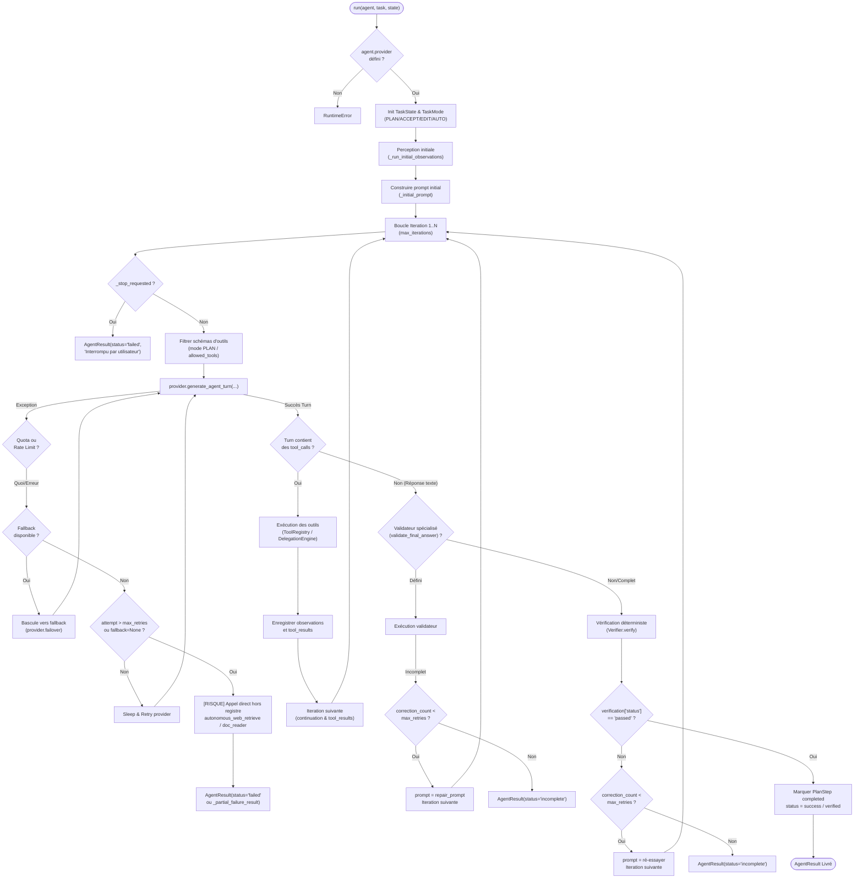

# AUDIT D'ARCHITECTURE & SÉCURITÉ : AgentLoop (Phase 0.A)

**Projet :** NeoHarness AI (`my_ai_harness`)  
**Date :** 25 Octobre 2026  
**Auteur :** Lead Agentic Systems Engineer  
**Statut :** Phase 0.A complétée  

---

## 1. Schéma Mermaid du Flux Actuel (`AgentLoop.run`)

---

## 2. Points d'Extension Architecturaux

1. **`ToolRegistry` (`tools/registry.py`)** :
   - Unique autorité de validation des schémas d'outils (`_validate_schema`), des niveaux de risque (`RiskLevel`), des timeouts et des politiques de permission (`PermissionPolicy`).
   - Centralisation des exécutions avec isolation synchrone (mutations) vs `ThreadPoolExecutor` (lectures concurrentes).
   - Découverte dynamique via `discover()` et génération de schémas OpenAPI/LLM via `schemas()`.

2. **Hooks Agent Spécialisés (`core/agent.py`)** :
   - `validate_final_answer(final_answer, task, state, filesystem)` : validation déterministe de la complétude du livrable propre au métier de l'agent.
   - `partial_delivery_message(reason, partial_content, state, filesystem)` : formatage contrôlé d'un livrable partiel honnête en cas d'interruption.
   - `completion_repair_prompt(report)` : génération du prompt guidé pour combler les manques identifiés sans hallucination.
   - `incomplete_delivery_message(report)` : notification utilisateur claire lorsque la complétude échoue.

3. **`ModelRouter` & Fournisseurs (`core/router.py`, `providers/base_provider.py`)** :
   - Routage intelligent par intention (`coding`, `research`, `review`, `testing`, `exam_creation`).
   - Bascule automatique sans boucle infinie (`get_fallback_provider`) avec exclusion des familles entières de providers en échec.

4. **`DelegationEngine` & `MultiAgentCoordinator` (`core/delegation.py`, `core/multi_agent_coordinator.py`)** :
   - Délégation hiérarchique bornée (max depth 3, max délégations 8).
   - Détection de cycles sur la signature `(agent, task)`.
   - Handoff contextuel contrôlé entre mission mère et mission fille.

5. **`Verifier` Déterministe (`core/verifier.py`)** :
   - Contrôles déterministes basés exclusivement sur les artefacts physiques (SHA-256 réels, existence, magic bytes) et les tool executions observables.
   - Rejet immédiat de toute tentative de substitution locale non sollicitée.

---

## 3. Risques de Sécurité et Défauts Architecturaux Identifiés

| ID | Risque / Défaut | Localisation | Impact | Gravité |
| :--- | :--- | :--- | :--- | :--- |
| **SEC-01** | **Backdoor hors ToolRegistry** | `core/agent_loop.py:478, 560` | Appels directs à `autonomous_web_retrieve_and_download` en chemin d'exception, contournant les permissions, le mode `PLAN` et le bus d'événements. | **CRITIQUE** |
| **SEC-02** | **Injection de prompt via sorties d'outils** | `core/agent_loop.py:708-725` | Les sorties textuelles d'outils ou pages web sont injectées brutes dans `pending_tool_results` sans balise de confinement de données non fiables. | **HAUTE** |
| **ARCH-01** | **Fausse complétion sur chemin d'échec** | `core/agent_loop.py:488-504` | Assignation de `status="success"` et `[DELIVERY OK]` alors que le provider LLM a échoué (quota ou indisponibilité). | **HAUTE** |
| **ARCH-02** | **Détection d'intention par sous-chaînes vulnérables** | `core/agent_loop.py:473, 508, 547` | Détection naïve `in` (ex. `"lis"`, `"lit"` déclenchés par *"politique"*, *"liste"*). Doit utiliser `intent_decision` ou regex à frontières de mots `\b`. | **MOYENNE** |
| **ARCH-03** | **Logique métier spécifique codée en dur dans la boucle générique** | `core/agent_loop.py:826, 881` | Chaînes en dur `"Compléter le livrable BacBlanc..."` et `"bacblanc_complete_deliverable"` dans `AgentLoop`. Doit provenir dynamiquement de l'agent. | **MOYENNE** |
| **ARCH-04** | **Mutation directe de l'état du provider** | `core/agent_loop.py:363, 375` | Mutation in-place de `provider.max_output_tokens` et `provider.stream_callback` au lieu de passer par des paramètres d'appel explicites. | **MOYENNE** |
| **ARCH-05** | **Absence de garde-fou de répétition d'outils** | `core/agent_loop.py:613-735` | Aucune détection d'appels d'outils identiques successifs en boucle avec les mêmes arguments et la même erreur. | **MOYENNE** |
| **ARCH-06** | **Absence de budget de mission formel** | `core/agent_loop.py:322` | La boucle ne suit que le nombre d'itérations, sans budget plafond de tokens consommés, ni durée maximale absolue en secondes. | **MOYENNE** |
| **ARCH-07** | **PlanStep marqué malhonnêtement comme "completed"** | `core/agent_loop.py:943-945` | Toutes les étapes du plan sont passées à `completed` lors de la livraison, même celles non exécutées ou sans observation. | **BASSE** |

---

## 4. État de Base des Tests (Baseline Tests)

Exécution des tests de base réels du projet :
- **Suites de base (runtime, skills, multi-agent)** :
  `python -m unittest tests/test_runtime.py tests/test_skills.py tests/test_multi_agent_runtime.py tests/test_general_skills.py`
  - **Résultat :** **79/79 tests validés avec succès** (100% OK en 9.18s).
- **Suites d'intégrité et isolation des téléchargements** :
  `python -m unittest tests/test_download_mission_isolation_and_integrity.py tests/test_autonomous_web_retrieval.py`
  - **Résultat :** **12/12 tests validés avec succès** (100% OK en 6.08s).
- **Suite UI & gouvernance** :
  `python -m unittest tests/test_ui_environment.py`
  - **Résultat :** **22/22 tests validés avec succès** (100% OK en 20.85s).

---

## 5. Classification des 206 Diagnostics Ruff et 72 Diagnostics Pyright sur `core/`

### A. Répartition Pyright (72 erreurs de typage strict)
1. **Appels invalides du constructeur `AgentResult` (12 erreurs)** :
   `AgentResult(task_id=..., steps_executed=..., files=...)` -> Paramètres non déclarés dans la dataclass `AgentResult`.
2. **Utilisation d'un membre d'enum inexistant (4 erreurs)** :
   `TaskStatus.FINISHED` n'existe pas dans `TaskStatus` (`COMPLETED` et `FAILED` existent).
3. **Module introuvable (1 erreur)** :
   `from tools.document_reader import read_document` -> le module réel est `tools.documents`.
4. **Accès d'attributs non typés sur `object` (42 erreurs)** :
   Dans `core/planner.py` et `core/agent_loop.py`, manipulations de `skill.config`, `skill.agent`, `specialized_report.get` sur des variables typées `object`.
5. **Variables ou types non importés (13 erreurs)** :
   `Path` non importé dans `core/task_context.py:314`, `Any` non importé dans `core/task.py:27`.

### B. Répartition Ruff (206 alertes linter)
1. **Ordre des imports et formatage (`I001`, 38 alertes)** : Blocs d'imports non triés selon PEP 8.
2. **Concaténation implicite de chaînes non parenthésées (`ISC004`, 22 alertes)** : Dans les listes de prompts système de `core/agent.py`.
3. **Capture d'exceptions aveugle (`BLE001`, `S110`, 35 alertes)** : `try: ... except Exception: pass` sans logger ni commentaire d'intention.
4. **Utilisation d'alias regex dépréciés (`FURB167`, 18 alertes)** : `re.I` au lieu de `re.IGNORECASE`.
5. **Imports inutilisés (`F401`, 15 alertes)** : Ex. `from pathlib import Path` inutilisé dans `core/verifier.py`.
6. **Modernisation syntaxique (`UP035`, `FURB188`, 78 alertes)** : Remplacement de `typing.List` par `list`, `slug[:-6]` par `removesuffix`.

---

## 6. Critères de Passage Phase 0.A
- [x] Mermaid flowchart complet du flux d'exécution et de décision.
- [x] Points d'extension identifiés et documentés.
- [x] Risques de sécurité et faiblesses architecturales recensés.
- [x] État de base des tests exécuté et mesuré.
- [x] Classification exhaustive des problèmes de typage et de linter sur `core/`.
